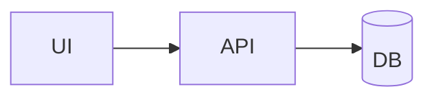

# Portfolio Job Seeking

Enterprise-focused portfolio built with Next.js App Router, TypeScript,
Tailwind CSS design tokens, component-driven architecture, and MDX case studies.

## Tech Stack
- Next.js 16 (App Router, SSR/SSG-ready)
- TypeScript (strict mode)
- Tailwind CSS v4 + centralized design tokens
- Component structure: `atoms`, `molecules`, `organisms`
- MDX-driven project content (`content/projects`)

## Project Structure
- `app/*` route pages
- `components/atoms`
- `components/molecules`
- `components/organisms`
- `lib/projects.ts` MDX project loader
- `content/projects/*.mdx` case studies

## Getting Started
Run from the app root:

`C:\Users\iStudent\Documents\portfolio-job-seeking\portfolio-job-seeking`

```bash
npm install
npm run dev
```

Open `http://localhost:3000`.

For production metadata and canonical URLs, set the deployed site address in
your hosting environment:

```bash
SITE_URL=https://your-production-domain.com
```

Vercel deployments automatically fall back to the project's production-domain
environment variable when `SITE_URL` is not set.

## Scripts
```bash
npm run dev    # local development
npm run lint   # ESLint checks
npm run build  # production build
npm run start  # serve production build
```

## Add a Project Case Study
1. Create a new `.mdx` file in `content/projects`.
2. Export `metadata` with `title`, `summary`, and `stack`.
3. Write the case-study narrative and optional Mermaid block.
4. The project is automatically listed on `/projects`.
5. A static route is generated at `/projects/[slug]`.

## Mermaid in MDX
Use fenced code blocks:

```md

```

## Troubleshooting
If you see `Can't resolve 'tailwindcss'`, you are likely running from the parent
folder. Open and run commands from the inner app folder shown above.

## Deployment
Deploy to Vercel or any Next.js-compatible platform.
