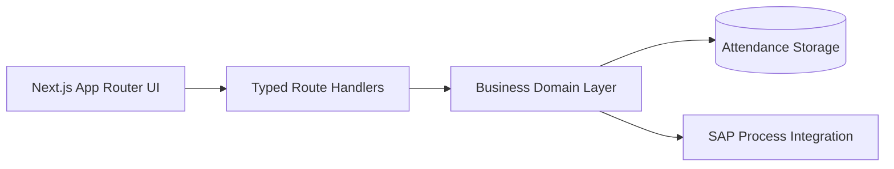

export const metadata = {
  title: "iHub Dashboard App",
  summary:
    "Migrated a legacy internal attendance flow to a typed Next.js stack with explicit architecture and predictable delivery.",
  stack: [
    "JavaScript",
    "React",
    "Tailwind CSS",
    "Express.js",
    "Node.js",
    "PostgreSQL",
  ],
};

# Context
A legacy attendance capture flow had inconsistent validation, weak UI feedback,
and no clear extension path.

# Problem
Recruiters and stakeholders need to see full-stack delivery quality, not only
UI screens. The system needed a maintainable architecture with typed boundaries.

# Solution
I implemented a modular Next.js architecture with component-driven UI,
centralized design tokens, and typed domain modules.

## Architecture Diagram (Mermaid)

# Outcome
- Faster onboarding for contributors through clear structure.
- Lower change risk using TypeScript and reusable components.
- Recruiter-friendly case study with explicit tradeoffs and architecture
  documentation.
