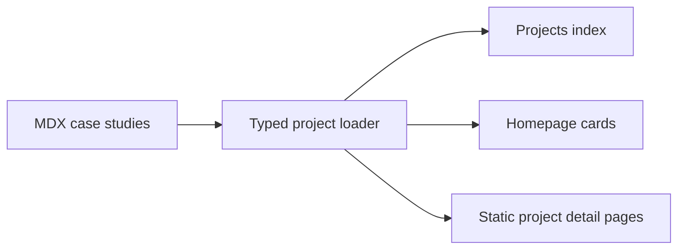

export const metadata = {
  title: "Developer Portfolio Platform",
  summary:
    "Designed and built a responsive, content-driven portfolio that presents technical projects as maintainable MDX case studies.",
  stack: ["Next.js", "React", "TypeScript", "MDX", "Tailwind CSS"],
  github: {
    status: "public",
    url: "https://github.com/KatlehoM22/portfolio-job-seeking",
  },
  screenshots: [
    {
      src: "/projects/portfolio_website/portfolio_screenshot.png",
      label: "Portfolio homepage",
      caption:
        "The full-width recruiter-focused homepage with direct project and contact pathways.",
    },
  ],
};

# Project overview

This portfolio is a responsive personal website designed to present my skills,
experience, and project work clearly to recruiters and engineering teams. It is
more than a collection of static pages: it is a reusable publishing platform
where project metadata, screenshots, and long-form case studies can evolve
without duplicating page layouts.

The finished site combines a distinctive developer-focused visual identity
with structured content, accessible interactions, responsive layouts, and
statically generated project pages.

## At a glance

- **Role:** Designer and Frontend Developer
- **Year:** 2026
- **Platform:** Responsive portfolio website
- **Status:** Active and continuously improved
- **Audience:** Recruiters, hiring managers, and software-development teams
- **Development workflow:** AI-assisted implementation with human review and automated validation

## The problem

A conventional portfolio can quickly become difficult to maintain when every
new project requires another manually assembled page. It can also leave
recruiters with attractive screenshots but little evidence of the developer's
decisions, responsibilities, or problem-solving process.

I needed a portfolio that could:

- communicate my professional profile within a short recruiter review;
- present projects as evidence-based case studies rather than image galleries;
- keep project content separate from reusable application layouts;
- remain visually consistent as new pages and projects are added;
- work comfortably across desktop and mobile screens;
- make updates straightforward without introducing duplicated code.

## My role

I designed and implemented the portfolio from end to end. My contribution
included:

- defining the information architecture and visual direction;
- designing the homepage, project cards, case-study experience, About, Skills,
  CV, and Contact pages;
- building reusable components for navigation, cards, headings, technology
  icons, screenshot media, and expandable case studies;
- creating a shared design-token system for colour, spacing, typography, and
  borders;
- implementing a typed MDX content pipeline for project metadata and narratives;
- developing responsive layouts for full-width desktop presentation and
  readable mobile navigation;
- adding semantic structure, keyboard-accessible controls, focus states, and
  reduced-motion support;
- validating changes with ESLint, TypeScript, and production builds.

## AI-assisted engineering workflow

I used AI coding assistants to accelerate selected parts of development while
retaining responsibility for the architecture, implementation decisions, code
review, and final validation.

### Where AI assisted

- exploring alternative component and responsive-layout approaches;
- scaffolding repetitive TypeScript and metadata structures;
- diagnosing build, hydration, and server/client boundary errors;
- drafting Playwright test scenarios;
- reviewing accessibility, recruiter-facing wording, and South African English;
- identifying refactoring opportunities and duplicated implementation.

### My responsibilities

I defined the requirements, selected the final architecture, reviewed generated
changes, and adjusted implementations to match the project's design system and
technical constraints. AI-generated suggestions were treated as proposals
rather than production-ready code.

Every accepted change was validated through:

- manual code and Git-diff review;
- ESLint and TypeScript checks;
- production builds;
- Playwright smoke tests;
- responsive testing down to a 320-pixel viewport;
- keyboard and accessibility checks.

### Practical example: mobile navigation

AI assistance helped explore and implement a mobile navigation component with
larger touch targets, active-page indicators, outside-click handling, and
keyboard support.

During validation, the production build exposed a Next.js server/client
boundary problem involving icon components. I corrected the architecture by
moving the navigation mapping behind an appropriate client boundary, then added
a Playwright test covering menu opening, Escape-key closure, and focus return.

This workflow allowed me to iterate quickly while maintaining ownership of the
technical decisions and quality of the final implementation.

## The solution

### Recruiter-focused information hierarchy

The homepage starts with a concise role statement, professional summary, clear
project and contact actions, and direct links to GitHub, LinkedIn, and email.
Project cards then provide immediate visual proof, a short outcome-oriented
summary, and the relevant technology stack.

Each project detail page follows a predictable sequence: title and value
proposition, technology stack, primary screenshot, and a collapsed case-study
preview. Readers can expand the narrative when they want more detail without
being presented with a long wall of text on arrival.

### Content-driven project architecture

Every case study lives in `content/projects` as an MDX file. A project exports
typed metadata—title, summary, stack, and an optional screenshot—alongside its
long-form content.

The project loader discovers those files, derives their slugs, normalises the
metadata, and supplies both the project index and dynamic detail routes. Adding
a project therefore requires content rather than another custom page component.

### Reusable design system

The interface uses shared CSS variables for the background, surfaces,
foreground colours, borders, accents, spacing, radii, and typography. Reusable
`tech-panel`, label, button, media, and card patterns create consistency without
repeating long groups of styles across pages.

Components are organised into atoms, molecules, organisms, and layout
primitives. This keeps small presentation elements separate from composed
features such as the header, footer, project cards, and expandable case-study
panel.

### Responsive and accessible interaction

The site uses full-width layouts with responsive page gutters rather than a
narrow fixed container. Project cards remain in a single row on the homepage
and become horizontally scrollable on small screens, preserving readable card
widths.

Navigation landmarks, descriptive link labels, semantic articles and figures,
keyboard-accessible buttons, visible focus states, alternative text, and
reduced-motion styles improve usability beyond pointer-based desktop browsing.

## Key engineering decisions

### Use MDX for technical storytelling

Project narratives need headings, lists, diagrams, screenshots, captions, and
reusable interactive components. MDX provides that flexibility while keeping
the content readable and version-controlled alongside the application.

### Generate routes from the content directory

Maintaining a separate hard-coded list of project routes would create two
sources of truth. Deriving slugs and summaries from the MDX files ensures the
homepage, project index, metadata, and static routes remain aligned.

### Keep presentation reusable

Screenshot frames, project cards, technology icons, and case-study behaviour
are implemented once and reused across projects. Individual case studies only
describe what is unique about the project.

### Collapse long narratives by default

Detailed case studies demonstrate engineering depth, but a recruiter may first
scan the page in seconds. The expandable panel exposes enough context to invite
interest while allowing the complete narrative to remain available on demand.

### Prefer static generation

Portfolio content changes less often than it is read. Generating project pages
at build time provides fast page delivery and avoids introducing a database or
content-management service that the project does not need.

## Technical challenges

### Balancing visual identity with readability

The grid background, dark palette, bright accents, and monospace labels create
a recognisable developer aesthetic. I limited those treatments to structural
and interactive elements while using conventional typography and spacing for
long-form content.

### Supporting rich MDX content consistently

Raw MDX elements can look disconnected from the application. Shared MDX
component mappings give headings, paragraphs, lists, code blocks, galleries,
and screenshots consistent styling without requiring presentation markup in
every case study.

### Presenting long case studies without clutter

Adding detailed project narratives and multiple screenshots increased the risk
of overwhelming the page. A primary image, collapsed content preview, fade cue,
bottom-corner expansion control, and contextual two-image galleries create a
progressive reading experience.

### Maintaining responsiveness after moving full width

Removing the narrow centred container gave projects more room, but cards and
media still needed sensible minimum widths. Responsive gutters, breakpoint
rules, horizontal card scrolling, and stacked mobile galleries preserve the
layout across screen sizes.

## Outcome

The portfolio now provides one consistent place to communicate my profile,
technical capabilities, and project experience. Its content architecture makes
new case studies faster to add and existing narratives easier to revise, while
the reusable interface keeps those additions visually consistent.

From an engineering perspective, the project demonstrates:

- Next.js App Router and static page generation;
- strict TypeScript and component-driven React development;
- MDX content modelling and dynamic module loading;
- responsive UI and reusable design-system thinking;
- accessible interaction and semantic HTML;
- technical communication through structured case studies;
- production validation with linting and build checks.

## What I learned

- A portfolio should optimise first for fast comprehension, then offer depth.
- Project outcomes and engineering decisions communicate more value than a
  technology list alone.
- Content architecture matters even for a relatively small personal website.
- Reusable media and MDX components make visual consistency easier to maintain.
- Responsive design requires testing content density, not only viewport width.
- Accessibility works best when treated as part of component design from the
  beginning.

## Future improvements

- Add automated accessibility checks to the test suite.
- Expand end-to-end coverage for navigation and case-study interactions.
- Add optimised screenshots for every contextual media placeholder.
- Introduce project filters when the number of case studies increases.
- Add structured metadata for richer search and social previews.
- Continue measuring and improving performance across mobile devices.
