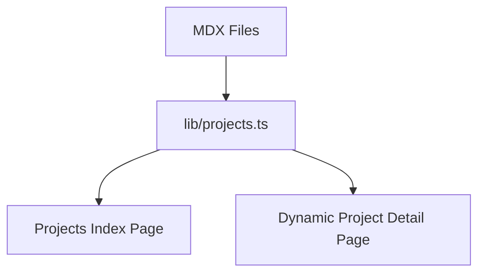

export const metadata = {
  title: "Portfolio Platform Architecture",
  summary:
    "Built a content-driven portfolio platform using MDX to separate presentation from technical narratives.",
  stack: ["Next.js", "MDX", "TypeScript", "Tailwind CSS"],
  screenshot: "/projects/portfolio_screenshot.png"
};

# Context
Static portfolio pages become hard to maintain when every project requires
manual JSX edits.

# Problem
I needed a system where project narratives can evolve quickly without touching
layout code.

# Solution
Project content is stored as MDX files, while list and detail pages pull
metadata dynamically via a typed loader.

## Content Flow

<CaseStudyGallery>
  <CaseStudyScreenshot
    label="Projects index"
    caption="The content-driven project listing generated from typed MDX metadata."
  />
  <CaseStudyScreenshot
    label="Case study experience"
    caption="The reusable detail-page layout for technical narratives and project evidence."
  />
</CaseStudyGallery>

# Outcome
- Content and layout are cleanly separated.
- Adding a new project requires adding one MDX file.
- Architecture and communication quality are now part of the portfolio itself.
